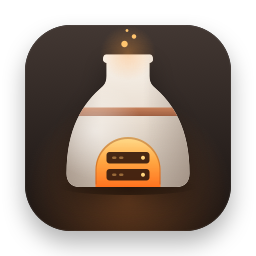
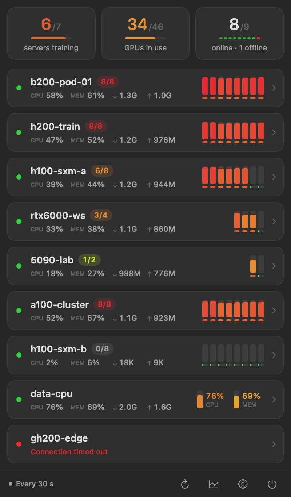
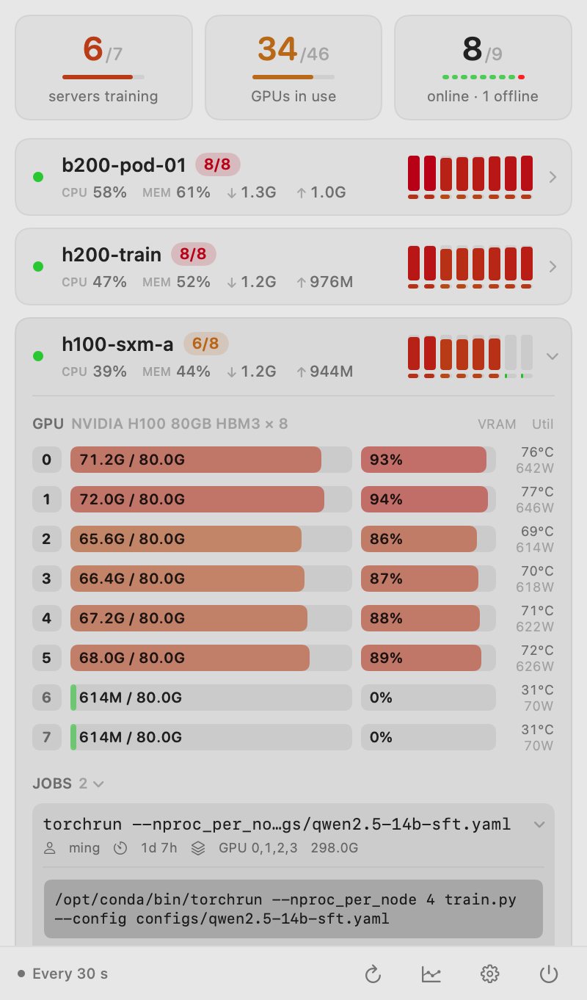
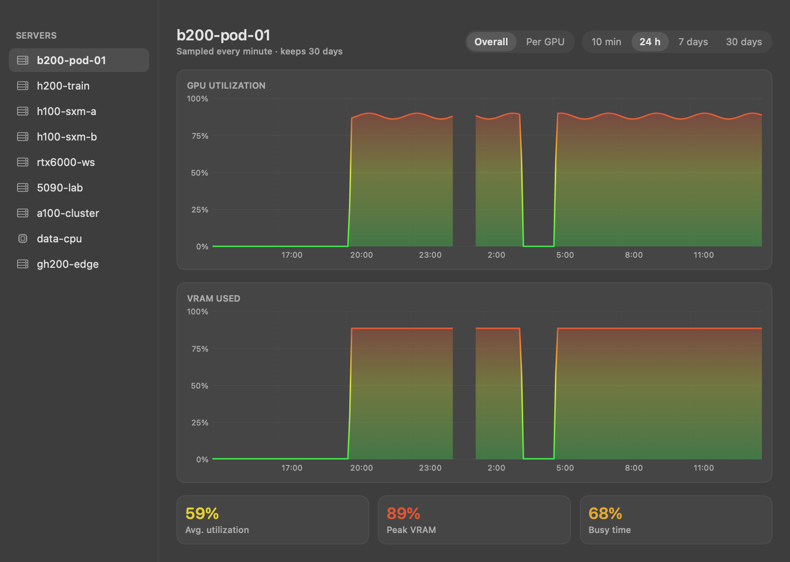

<p align="center">
  
</p>

<h1 align="center">ServerKiln</h1>
<p align="center">Your GPU servers, at a glance. Right in the Mac menu bar.</p>
<p align="center">
  <a href="https://github.com/Littleor/server-kiln/releases/latest"></a>
  <a href="https://github.com/Littleor/server-kiln/actions/workflows/ci.yml"></a>
  <a href="LICENSE"></a>
  
  
</p>
<p align="center"><b>English</b> · <a href="README.zh-CN.md">简体中文</a></p>
<p align="center">
  <a href="https://github.com/Littleor/server-kiln/releases/latest">Download for Mac</a> ·
  <a href="docs/getting-started.md">Get started</a> ·
  <a href="docs/troubleshooting.md">Troubleshooting</a> ·
  <a href="https://serverkiln.littleor.cn/en/">Website</a>
</p>

ServerKiln is a native SwiftUI menu bar app for watching remote Linux servers
over SSH. See which GPUs are busy, inspect training processes, follow resource
history and get notified when a machine becomes idle. Basic monitoring uses
your existing SSH configuration and installs no server daemon.

## See your fleet

<p align="center">
  
  
</p>
<p align="center"></p>
<p align="center"><sub>All screenshots use synthetic demo servers and workloads.</sub></p>

## Why ServerKiln?

| Feature | What you get |
| --- | --- |
| Menu bar overview | One or two configurable rows for busy servers, GPU counts and VRAM |
| Per-GPU details | Utilization, VRAM, temperature and power; CPU-only servers also work |
| Running tasks | Process commands, working directories, elapsed time and recent task history |
| Adaptive refresh | Faster polling while the panel is open; slower polling in the background |
| History | Recent live samples and local 24-hour, 7-day and 30-day resource charts |
| Notifications | Debounced busy/idle changes, optional connection alerts, per-server mute |
| Familiar SSH | Import `~/.ssh/config`; use existing keys, ssh-agent and jump-host configuration |
| Native interface | SwiftUI, light/dark appearance, English and Simplified Chinese |
| Optional iPhone companion | The official signed Mac build can relay status and provision dedicated keys through iCloud |

## Install

1. Download **`ServerKiln-<version>-universal.dmg`** from [GitHub Releases](https://github.com/Littleor/server-kiln/releases/latest).
2. Open it and drag **ServerKiln** into **Applications**.
3. Launch ServerKiln, allow notifications if you want alerts, and import your SSH hosts.

Requires **macOS 14 or later**. The same download supports **Apple Silicon and
Intel**. Official release downloads are Developer ID signed and Apple notarized.
A ZIP and `SHA256SUMS` are also provided. Updates are manual: install a newer
release over the existing app; preferences and history are retained.

For monitoring, the remote machine needs Linux, `/bin/sh`, common system tools
and key-based SSH login. NVIDIA GPU metrics need `nvidia-smi`; CPU and memory
monitoring still work without it. AMD GPU metrics are not currently supported.

See [setup and checksum verification](docs/getting-started.md).

## Privacy and iPhone support

Basic monitoring runs locally: credentials stay in your existing SSH setup,
and history stays on your Mac. No analytics SDK or project-operated telemetry
backend is included. SSH reads process commands and paths, so treat diagnostic
output as sensitive. See [the data flow and security model](docs/security-and-privacy.md).

This repository contains the **macOS app and the shared code required by its
Mac features**. The iPhone app and widgets are distributed separately and are
not covered by this repository's MIT license. Their source is not included.
The Mac's optional companion integration is included; using the official iCloud
container requires the official signed Mac build. A local ad-hoc build fully
supports Mac monitoring, but cannot use that container.

## Build from source

Use **Xcode 26.3 / Swift 6.2 or later** on macOS. The pinned dependencies require
a newer toolchain than the app's macOS deployment target.

```bash
git clone https://github.com/Littleor/server-kiln.git
cd server-kiln
swift test --force-resolved-versions
scripts/build-app.sh
open dist/ServerKiln.app
```

The build script packages both architectures, localization resources, icons and
license notices, then signs the bundle ad hoc. For development, `swift run
ServerKiln` starts the app directly (without bundled translations, notifications
or iCloud). [Development guide](docs/development.md) · [Release guide](docs/releasing.md).

## Contribute

Bug reports, documentation, translations and focused pull requests are welcome,
in English or Chinese. Start with [CONTRIBUTING.md](CONTRIBUTING.md) and the
[architecture overview](docs/architecture.md). Please use demo data in screenshots
and remove hostnames, usernames and sensitive commands from reports.

[Report a bug](https://github.com/Littleor/server-kiln/issues/new/choose) ·
[Get help](SUPPORT.md) · [Report a security issue](SECURITY.md) ·
[Changelog](CHANGELOG.md)

## License and acknowledgments

[MIT](LICENSE), copyright © 2026 Littleor. Dependencies retain their own
licenses; see [third-party notices](THIRD_PARTY_NOTICES.md). Built with SwiftUI,
SwiftNIO SSH, Swift Crypto and the system OpenSSH client.

[Mac in-app updates](docs/mac-updates.md): GitHub Releases / Sparkle，确认后安装。
