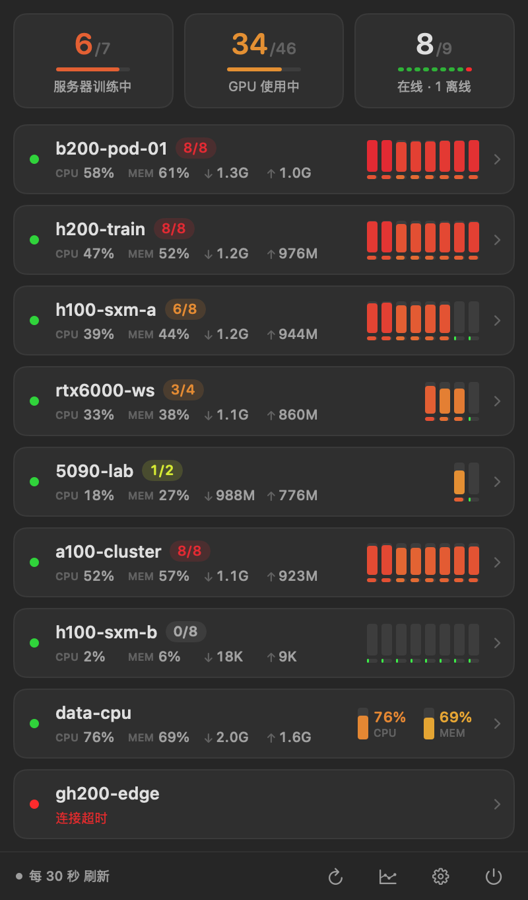
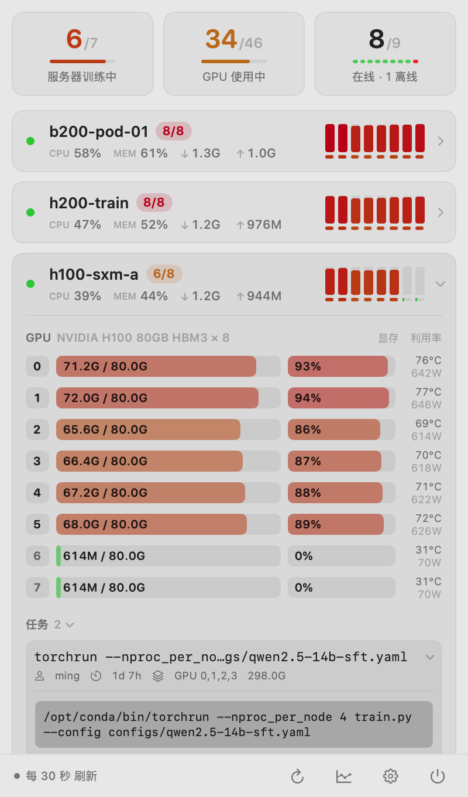
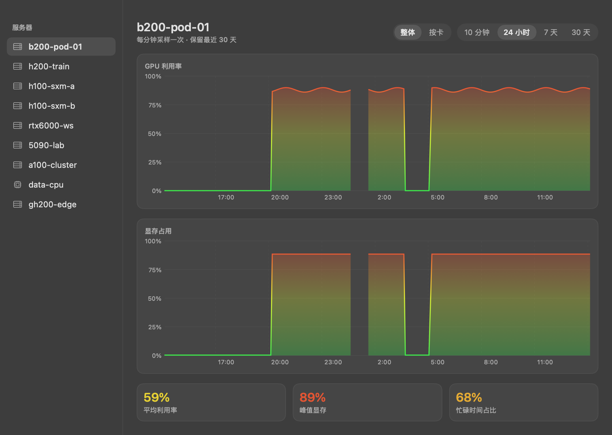

<p align="center"></p>
<h1 align="center">ServerKiln</h1>
<p align="center">扫一眼 Mac 菜单栏，掌握整组 GPU 服务器的状态。</p>
<p align="center">
  <a href="https://github.com/Littleor/server-kiln/releases/latest"></a>
  <a href="https://github.com/Littleor/server-kiln/actions/workflows/ci.yml"></a>
  <a href="LICENSE"></a>
  
</p>
<p align="center"><a href="README.md">English</a> · <b>简体中文</b></p>
<p align="center">
  <a href="https://github.com/Littleor/server-kiln/releases/latest">下载 Mac 版</a> ·
  <a href="docs/getting-started.md">快速开始</a> ·
  <a href="docs/troubleshooting.md">常见问题</a> ·
  <a href="https://serverkiln.littleor.cn/zh/">官网</a>
</p>

ServerKiln 是一个原生 SwiftUI 菜单栏工具，通过 SSH 监控远端 Linux 服务器。
查看每张 GPU 的使用情况、训练进程与资源历史，并在服务器变空闲时收到通知。
基础监控沿用现有 SSH 配置，无需在服务器安装常驻服务。

## 界面预览

<p align="center">
  
  
</p>
<p align="center"></p>
<p align="center"><sub>截图全部使用虚构的演示服务器和任务。</sub></p>

## 功能

| 功能 | 说明 |
| --- | --- |
| 菜单栏总览 | 单行或双行独立配置，显示忙碌服务器、GPU 数量和显存 |
| 单卡监控 | 利用率、显存、温度、功耗；同时支持纯 CPU 服务器 |
| 任务详情 | 查看命令、工作目录、运行时间及近期任务记录 |
| 自适应刷新 | 打开面板时加快采集，收起后恢复后台间隔 |
| 本地历史 | 近期实时采样与 24 小时、7 天、30 天资源曲线 |
| 状态提醒 | 忙碌／空闲切换防抖、可选连接提醒、单服务器静音 |
| 现有 SSH 配置 | 导入 `~/.ssh/config`，使用现有密钥、ssh-agent 和跳板机配置 |
| 原生体验 | SwiftUI、深浅色、中英文即时切换 |
| 可选 iPhone 配套 | 官方签名 Mac 版通过 iCloud 中转状态，并部署独立访问密钥 |

## 安装

1. 从 [GitHub Releases](https://github.com/Littleor/server-kiln/releases/latest) 下载 **`ServerKiln-<版本>-universal.dmg`**。
2. 打开 DMG，把 **ServerKiln** 拖到 **Applications（应用程序）**。
3. 启动应用，按需允许通知，导入 SSH 服务器。

需要 **macOS 14 或更新版本**，同一个安装包支持 **Apple Silicon 和 Intel**。
官方发布包使用 Developer ID 签名并经过 Apple 公证，同时提供 ZIP 和 SHA-256 校验文件。
更新时手动安装新版，保留已有设置与历史。

远端需为 Linux，支持密钥 SSH 登录并具备 `/bin/sh` 等常用系统工具。
NVIDIA GPU 信息依赖 `nvidia-smi`；没有 GPU 时仍可查看 CPU 和内存。
目前不支持 AMD GPU 指标。参阅[配置与校验说明](docs/getting-started.md)。

## 隐私与开源范围

基础监控的数据保留在本机，使用现有 SSH 凭据，没有分析 SDK 或项目自建的遥测服务。
采集结果包含进程命令和路径，分享日志前请脱敏。
可选的 iCloud 功能会同步服务器信息与状态，详见[安全与数据流](docs/security-and-privacy.md)。

本仓库仅开源 **macOS 应用及其功能所需的共用代码**。
iPhone App 和小组件另行分发，其源代码不在本仓库，也不受本仓库 MIT 许可证覆盖。
Mac 侧的配套同步功能已包含在源码中；访问官方 iCloud 容器需要官方签名版本。
自行构建的 ad-hoc 版本可完整使用 Mac 本地监控，但无法访问官方 iCloud 容器。

## 从源码构建

需要 macOS 与 **Xcode 26.3 / Swift 6.2 或更新版本**。锁定的依赖要求较新工具链，
不影响发布包在 macOS 14 上运行。

```bash
git clone https://github.com/Littleor/server-kiln.git
cd server-kiln
swift test --force-resolved-versions
scripts/build-app.sh
open dist/ServerKiln.app
```

脚本自动打包通用二进制、中英文资源、图标及依赖许可，并完成 ad-hoc 签名。
开发时可使用 `swift run ServerKiln`，但这种运行方式没有打包后的翻译、系统通知和 iCloud。
详见[开发指南](docs/development.md)与[发布指南](docs/releasing.md)。

## 参与项目

欢迎用中文或英文提交问题、改进文档、翻译和 Pull Request。
请先阅读[贡献指南](CONTRIBUTING.md)和[架构说明](docs/architecture.md)。
截图请使用演示数据，日志请移除真实主机、用户名及敏感命令。

[问题反馈](https://github.com/Littleor/server-kiln/issues/new/choose) ·
[获取帮助](SUPPORT.md) · [安全反馈](SECURITY.md) · [更新日志](CHANGELOG.md)

## 许可证

[MIT](LICENSE)，Copyright © 2026 Littleor。第三方依赖保留各自许可，
详见[第三方声明](THIRD_PARTY_NOTICES.md)。
