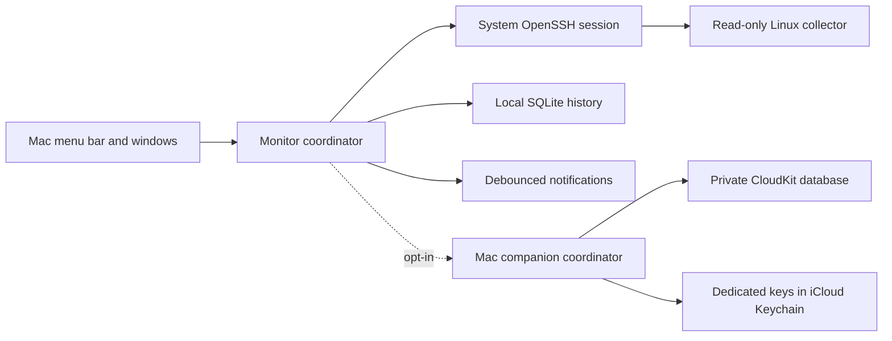

# Architecture

ServerKiln keeps collection and state logic separate from the SwiftUI app.

| Directory | Responsibility |
| --- | --- |
| `Sources/ServerKiln` | App lifecycle, settings, monitor, notifications, views and demo rendering |
| `Sources/ServerKilnCore` | Models, SSH config parsing, system SSH sessions, collection script, history and transitions |
| `Sources/ServerKilnSSH` | SwiftNIO SSH client for verifying dedicated key deployments and remote sessions |
| `Sources/ServerKilnSync` | Mac companion key deployment, CloudKit transport and shared payload types |
| `Sources/ServerKilnUI` | Reusable view components, palette and synthetic demo fleet |
| `Resources` | Localization catalog and third-party licenses |
| `Config` | Mac entitlements; generated Info.plist is ignored |
| `Tests` | Core, persistence, deployment and local SSH integration tests |
| `Vendor` | Reviewed SwiftNIO SSH patch with upstream attribution |
| `scripts` | Build, validation and release tooling |

`Monitor` owns sampling and session lifetime. An open panel requests the faster
interval. `SnapshotParser` converts the collector's framed output to typed
metrics. `TransitionTracker` debounces state changes; `TaskTracker` groups related
GPU processes and tolerates short sampling gaps. `HistoryStore` stores samples
and serves bucketed queries to Charts.

Normal monitoring uses system OpenSSH, including the user's existing config.
The separate SwiftNIO transport verifies provisioned companion keys, where
explicit host-key pinning and restricted access must match the deployed setup.

The repository deliberately contains no companion application or widget target.
Shared protocols needed for Mac-side integration remain here. Generated Xcode
projects, signing material and release artifacts are not committed.
