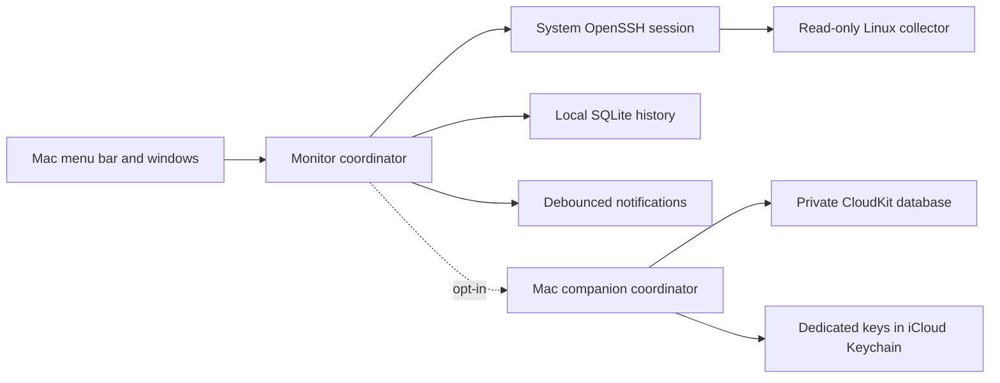

# Architecture

ServerKiln keeps collection and state logic separate from the SwiftUI app.

| Directory | Responsibility |
| --- | --- |
| `Sources/ServerKiln` | App lifecycle, settings, monitor, notifications, views and demo rendering |
| `Sources/ServerKilnCore` | Models, SSH config parsing, system SSH sessions, collection script, history and transitions |
| `Sources/ServerKilnSSH` | SwiftNIO SSH client for verifying dedicated key deployments and remote sessions |
| `Sources/ServerKilnSync` | Mac companion key deployment, CloudKit transport and shared payload types |
| `Sources/ServerKilnUI` | Reusable view components, palette and synthetic demo fleet |
| `Resources` | Localization catalog and third-party licenses |
| `Config` | Mac entitlements; generated Info.plist is ignored |
| `Tests` | Core, persistence, deployment and local SSH integration tests |
| `Vendor` | Reviewed SwiftNIO SSH patch with upstream attribution |
| `scripts` | Build, validation and release tooling |
| `Sources/ServerKiln.Windows` | Independent WPF app, tray, DPAPI secrets and Windows integration |
| `Sources/ServerKiln.Windows.Core` | Windows SSH sessions, parsing, state, SQLite and Bark transport |
| `Resources/Collector` | Generated Windows copy of the unchanged Swift collector |
| `Tests/SharedFixtures` | Synthetic parsing contract exercised by both Swift and C# |
| `global.json` | Pinned .NET SDK for Windows builds |

`Monitor` owns sampling and session lifetime. An open panel requests the faster
interval. `SnapshotParser` converts the collector's framed output to typed
metrics. `TransitionTracker` debounces state changes; `TaskTracker` groups related
GPU processes and tolerates short sampling gaps. `HistoryStore` stores samples
and serves bucketed queries to Charts.

Normal monitoring uses system OpenSSH, including the user's existing config.
The separate SwiftNIO transport verifies provisioned companion keys, where
explicit host-key pinning and restricted access must match the deployed setup.

The repository deliberately contains no companion application or widget target.
Shared protocols needed for Mac-side integration remain here. Generated Xcode
projects, signing material and release artifacts are not committed.

The Windows client invokes native Windows OpenSSH through argument lists and
redirected pipes. It owns one persistent process per host and uses the same
collector framing and busy policy as the Mac. Its C# core is a separate
implementation, with shared fixtures to check behavioral equivalence. Windows
data is stored under LocalApplicationData. An optional Bark transport provides
iPhone notifications independently of the Mac's CloudKit / Keychain integration.
See the [Windows guide](windows.md) for the build and security boundaries.
Windows live curves use a bounded in-memory ten-minute buffer; minute samples
remain in SQLite for longer ranges. Per-GPU charts group by GPU before drawing
and preserve missing-sample gaps. Valid SSH host-key stores remain inherited;
native `ssh -G` detects discard-only configurations for a persistent fallback.
