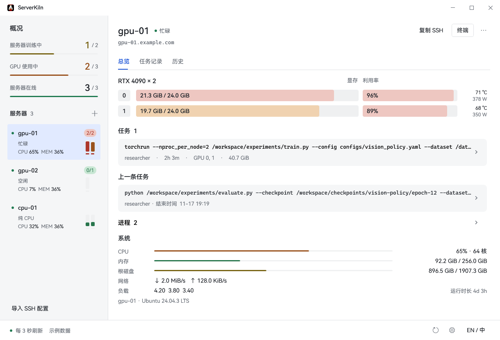
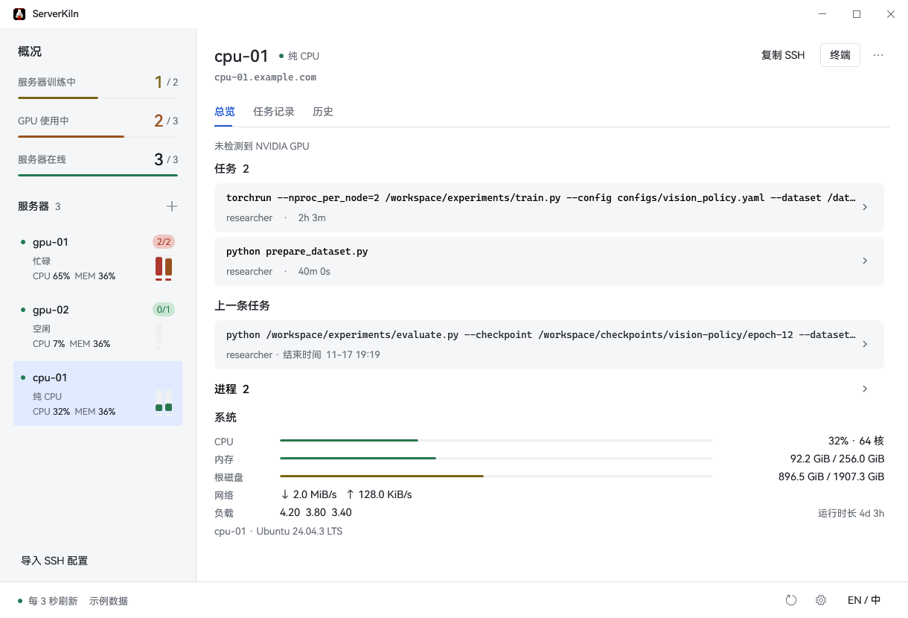
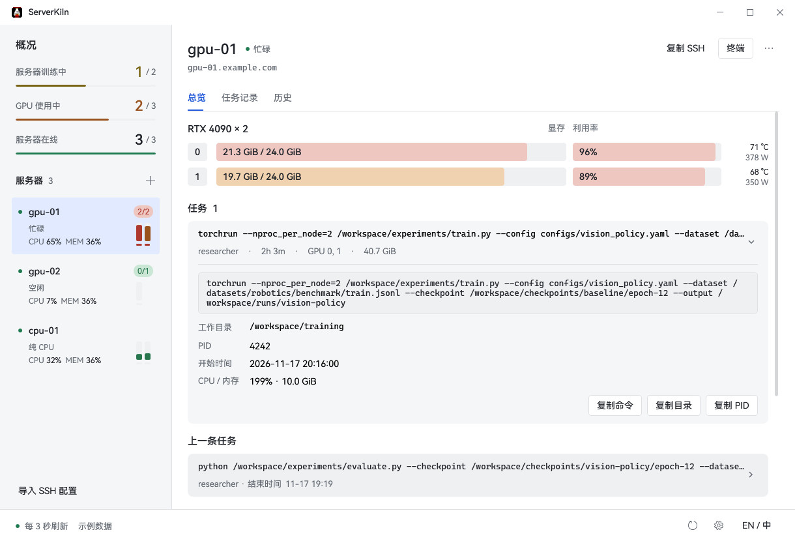
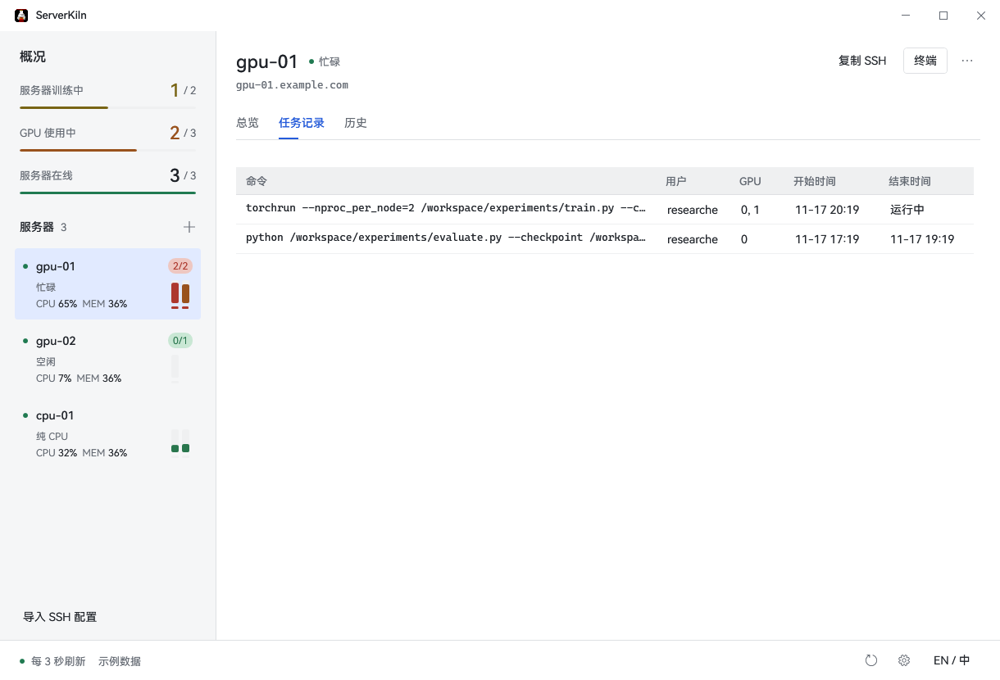
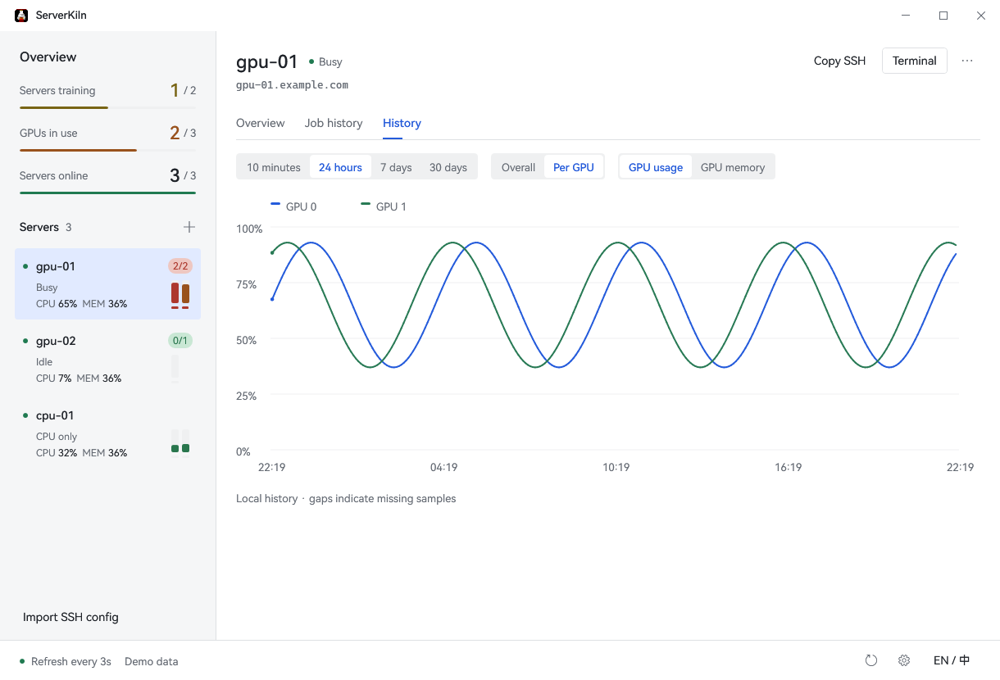
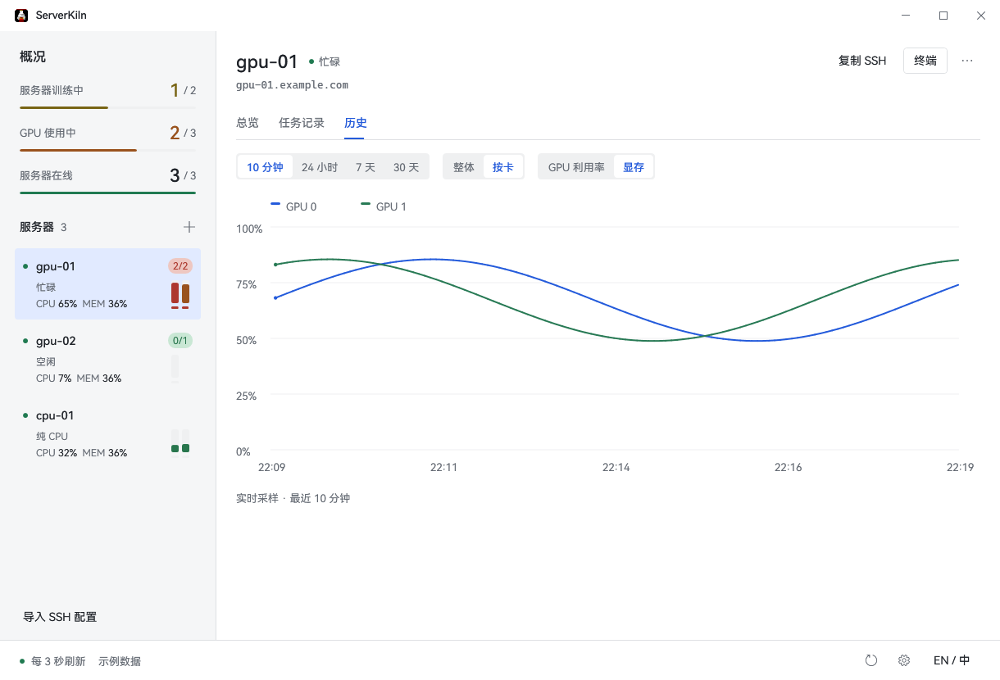
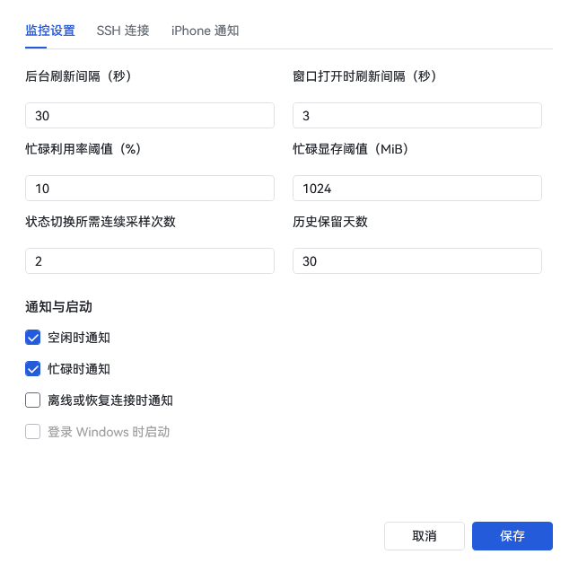

# Windows compatibility and contribution scope

This contribution adds an independent Windows desktop client. It keeps the
existing Mac app, Apple signing, CloudKit integration and Mac packaging scripts.
The Windows core is C#, rather than a Windows build of SwiftUI. Its behavioral
contract is the shared collector, fixture corpus and documented sampling rules.
The shared Swift parser also accepts CRLF line endings, covered by the same
fixture corpus; the Mac UI, collector and signing configuration are unchanged.

## Feature matrix

| Capability | macOS | Windows contribution |
| --- | --- | --- |
| Existing OpenSSH configuration, agent and jump hosts | System OpenSSH | Native Windows OpenSSH; platform-specific proxy executables must exist on Windows |
| Unknown / changed host keys | OpenSSH configuration | Strict monitoring; interactive confirmation for first connection |
| Custom known-hosts files / host CA entries | Inherited | Inherited unchanged; discard-only configurations use a persistent fallback |
| Private key selection | SSH configuration | SSH configuration plus optional per-server file override |
| GPU / CPU / RAM / disk / network / process metrics | Available | Available, same Linux collector |
| Busy policy and transition debounce | Available | Same thresholds and consecutive-observation rule |
| Resource history | 10 minutes / 24 hours / 7 days / 30 days | Same ranges and bucket sizes |
| Aggregate / per-GPU resource curves | Available | Available; per-GPU utilization / VRAM selection |
| Recent jobs and task grouping | Available | Available, persisted separately from resource samples |
| Desktop shell | Menu bar with configurable text | System tray with tooltip summary and a dashboard window |
| Desktop notifications | Apple notifications | Windows tray notifications |
| Installation / shortcuts / login startup | Mac app bundle / ServiceManagement | Per-user portable installation, desktop + Start menu shortcuts, optional login startup |
| Chinese / English and appearance | Chinese / English; light and dark | Chinese / English; light only |
| Update channel | Sparkle + official signed releases | Manual replacement; self-contained ZIP + SHA-256 |
| Phone notifications | Official iCloud integration | Optional independent Bark integration |
| Original iPhone app / widgets / mobile terminal | Official Apple integration | Outside this desktop contribution; requires coordinated iOS / Windows protocol work |

The initial support claim is **Windows 11 x64**. ARM64 packaging can be requested
with the build script, but ARM64 and Windows 10 22H2 require device acceptance
before being advertised as tested support. Authenticode signing and automatic
Windows updates are separate release-policy decisions.

## SSH trust behavior

The client resolves effective options using native `ssh -G` once when opening a
session. This includes the selected config, port, alias, Include and Match rules;
it does not connect to the server. Valid `UserKnownHostsFile` settings are left
unchanged, including multiple files and paths with spaces. OpenSSH continues to
interpret host CA entries, aliases, tokens and global trust files.

If the effective user store consists entirely of `/dev/null`, `NUL` or `none`,
interactive setup and monitoring both use `%LOCALAPPDATA%\ServerKiln\known_hosts`
with the standard Windows OpenSSH user store as a fallback. Mixed configurations
that include a valid file remain inherited. The app never removes a saved key
or accepts an unknown / changed key automatically. Existing SSH configuration
and private key contents are not rewritten.

## Reviewer entry points

- [Windows installation and usage](windows.md)
- [Validation record and remaining device checks](windows-validation.md)
- [Architecture](architecture.md)
- [Security and privacy](security-and-privacy.md)
- `Sources/ServerKiln.Windows.Core`: OpenSSH, SQLite, parsing, recent samples and policies.
- `Sources/ServerKiln.Windows`: WPF UI, notifications, shortcuts and DPAPI integration.
- `Tests/SharedFixtures`: synthetic contract cases consumed by Swift and C#.
- `scripts/build-windows.ps1 -Package -Snapshots`: tests, WPF rendering, distributable ZIP and synthetic screenshots.

## Synthetic interface previews

These previews use only fictional hosts and workloads. They are generated by
the application's isolated `--snapshot` mode, which performs no SSH connections
and sends no phone notifications.

